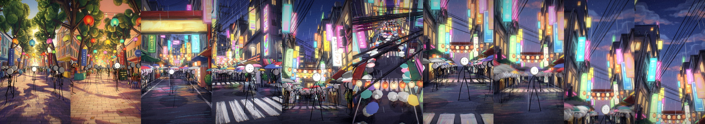

# claude-stickman-crowd-mv

A Claude Code skill: a music Short where one stick figure is alone in a crowded, hand-painted 3D street.

- the streets are a Blender blockout repainted by an image model and projected back on the 3D set (the
  [painted-3d-short](https://github.com/thuann-vn/claude-painted-3d-shorts) method),
- 100–200 stick people per shot are animated in code: a planted-foot walk, umbrellas in the rain, phones at the ear,
  lamp light on the heads, cast shadows,
- a time-lapse ending (the crowd runs 14× faster, the camera turns up to the sky),
- a finishing pass: bloom, grain, handheld drift, cuts and a pulse on the song's kick.

No video model is used.

## Layout

- `stick-crowd-mv/SKILL.md` — the method and the lessons learned.
- `stick-crowd-mv/tools/stick.py` — the crowd (Blender Python).
- `stick-crowd-mv/tools/gait.py` — the procedural walk.
- `stick-crowd-mv/tools/post.py` — the finishing pass (OpenCV).
- `stick-crowd-mv/example/` — the two sets, the repaint prompts, the paintings, idle clips.

## Install

Copy `stick-crowd-mv/` into `~/.claude/skills/`, next to `painted-3d-short/`.

## What you must bring yourself

- **Blender 5.x**, **ffmpeg**, Python with numpy and OpenCV.
- **painted-3d-short** (`p3d.py`) and an image model that repaints a picture from a reference (see that repo).
- **Your own music.** No audio is included; `post.py` reads `clip.m4a` next to the scene files.
- The example scripts expect `stick.py`, `gait.py`, `post.py` and `m2m.json` in the same folder as `scene.py`.

## Credits

- Idle clips in `example/m2m.json`: joint positions extracted from [Mesh2Motion](https://github.com/Mesh2Motion/mesh2motion-app) animations (CC0).
- The walk follows the planted-foot gait of the studio's 2D stick rig.
